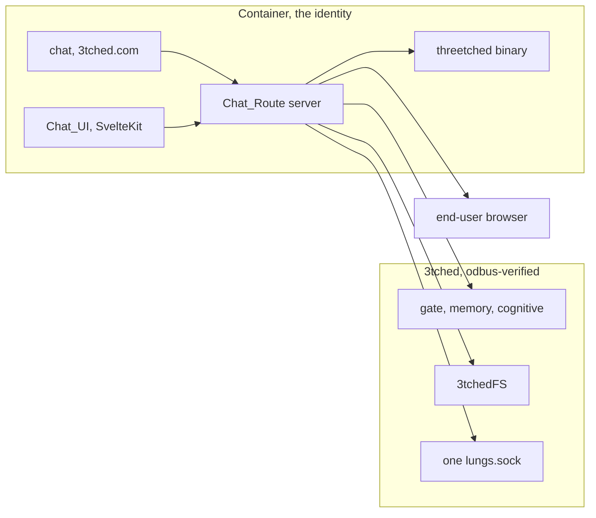

# Design — Container chat

Status: draft. Authorizes no file move, container start, or deploy. Chat is
the part that changes. The 3tched base and the network host bridge stay
where they are. This design names no Incus instance and no disk. It does
not adopt the loop-backed container layout checked into odbus-verified.

## Overview

`/srv/git/3tched.com` is the container repo. It owns all of chat, the range
of services, and the threetched install. Chat runs inside the container.
That is where the gate passes. Host port 8080 does not pass.

The `identity-chat-interface` spec in `/srv/git/odbus-verified` is the
previous design. Its Host_Dashboard placement and unresolved blockers are
resolved here: the chat process runs only in the container, the Bound_Identity
is the container, and the Lungs_Socket is the only hop into 3tched.

threetched is the upstream ZeroClaw binary, renamed, with no patches. It is
binary-backed. It is not our code and not 3tchedFS.

## Architecture

Install is two repos. The container repo installs on the 3tched base.
Runtime crosses: chat calls 3tched for the gate and the filesystem, and
calls the binary for models, providers, and skills.

## Components and interfaces

### Chat_Route

The Chat_Route is a Rust process inside the container. It owns:
- Session management and identity binding (Bound_Identity from
  `identity_sled.get_own_identity` through the FUSE mount).
- Credential handling (Secret_Guard).
- Schema validation against sealed method schemas.
- The confirmation gate for mutation methods.
- The tool executor that maps model tool calls to FUSE Operation_File calls.
- The chain verifier that links Receipts to Execution_Records.
- The turn loop that runs model steps until tools are exhausted or the
  Session_Mode limit is reached.
- Offered methods read from the Bound_Identity's mount. A tool is a plugin
  method. There is no tool registry.

The Chat_Route is Rust. The modules already implemented for this contract
are `errors`, `guard`, `profile`, `validation`, `gate`, `state`, `status`,
`chain`, and `types`. They move with the container install. The browser
stays Svelte in this repo. This design does not add a TypeScript server.

The existing `chat-route` binary in `/srv/git/odbus-verified` still binds
`10.0.0.2:50051`. That bind is the old host placement. This design does
not keep it and does not edit that binary.

The Chat_Route does not spawn `3tched-fs`. It does not bind a host listener,
including port 8080. It does not connect to Door_8090 directly. It reaches
the 3tched base only through the Lungs_Socket. How the rendered spec leaves
the container for the user's browser is still open. That open question does
not add a host listener.

### Chat_UI

The Chat_UI is a SvelteKit / Svelte 5 application using the AI SDK Chat
component with a custom gRPC-Web ChatTransport. It delivers the conversation
stream to the end user's browser. It renders via json-render Svelte. The
container does not run a desktop or Wayland compositor. The user's browser
renders the page.

### threetched binary

The upstream ZeroClaw binary supplies models, providers, and skills. The
Chat_Route calls it through the AI SDK provider package. 3tched does not
grow a second implementation of it. The threetched binary is installed on
top of base 3tched as part of the container deployment.

### Bound_Identity and 3tchedFS

The chat process runs under the sealed identity of the container. Its mount
carries the identity. Every Operation_File call uses the Bound_Identity's
mounted namespace. The mount is a runtime mirror of SHM. The sealed catalog
may name `threetched` as the binary surface. That name is the binary, not
a second copy of our code.

### Identity issuance

The container is the identity. One key, the WireGuard public key K, names
both: `session_id = derive_session_id(K)` is the Incus instance name, and
grants use `principal_id = derive_principal_id(K)`. No session or principal
id is written by hand.

The decoy issues identity. WireGuard terminates there, so it is the one
place that observes K. It mints the genesis and SID1 for K, with the NextDNS
context sealed in, and delivers the blob signed with its trusted signing key.
Provisioning writes that blob to `/agent/user/sealed_id` before first boot.
On first start the container's door verifies the decoy signature, that the
key is K, and that `session_id` is its own instance name, then commits the
SID1 as its sled's `sealed_id`. From then on the container is the identity
owner. The host carries the blob and never mints, signs or edits it.

The genesis inputs are K, a chain head and its timestamp, a sealed-catalog
hash and the arrival timestamp. No hardware value is an input. The sled is
not durable; `sealed_id` is the sled's persistence. The Control Plane
chatbot's sled is a `service` principal and never resolves implicitly.

### Container connectivity (no NIC)

Owner decision, 2026-11-13. A container has no network interface except
`lo`. It has no veth, no Incus NIC device and no per-container OVS port. All
connectivity runs over Unix sockets in the host-shared directory
`/run/opdbus/lungs/`, which the kernel identifies by peer credentials.

Two sockets, two owners:

| Socket | Server | Carries |
|---|---|---|
| `lungs/<container>/lungs.sock` | the container's door (`op-grpc-bridge`) | 3tchedFS plugin calls (D-Bus `PluginV1`) |
| `lungs/tunnel.sock` | the host mux (tonic) | all container network streams, both directions |

Lungs carries plugin calls only. Each container gets its own path so doors do
not collide in the shared directory.

The tunnel socket replaces the container egress proxy (host Xray
`http.sock`, the guest socat on `127.0.0.1:3128`). It is a tonic gRPC service
over the Unix socket: one bidirectional stream per connection, the first
message names the target, then bytes in both directions. HTTP/2 multiplexes
streams over one socket connection; deadlines and cancellation tear down the
connection. The mux identifies the calling container from the Unix peer
credentials (`UdsConnectInfo`), never from request data, and publishes its
service through gRPC reflection.

The mux runs in a relay network namespace that owns one OVS internal port on
`ovsbr0` (`ovsbr0-sock`, the openflow plugin's `SharedIngress` socket port).
Outbound streams leave through that port and the bridge's `eth0` uplink, using
a source address or port per container so OpenFlow attributes each flow to its
container. OpenFlow decides what is forwarded, and admission stays with the
container's door and the mux. Inbound connections for a container's door (the
decoy's proof forward to `10.0.0.2:8090`) arrive at the mux on the bridge side
and are spliced to that container's door over the tunnel socket; TLS still ends
inside the container.

Open: whether outbound streams leave directly through the uplink or through
the decoy (REALITY/WARP); the mux and the relay namespace are not built; the
earlier `op-ghostbridge-mux` code is not in any repository.

### Lungs_Socket

One socket, `/run/opdbus/lungs/lungs.sock`. The Chat_Route connects to it
from the container. The kernel peer distinguishes callers. The network does
not implement this socket. The chat does not create a socket per caller.

### Secret_Guard

The Secret_Guard classifies output items as containing Credential_Material
when they include a complete credential value, a 16+ byte substring, or a
SID1/OIA1 envelope. It blocks the output on the server, keeps pending
Tool_Calls unchanged, and records a security event. For message streams, it
checks each chunk with a hold-back buffer so values split across chunks
are detected before any byte leaves the Chat_Route.

### Confirmation_Gate

Holds pending mutation calls, computes a digest from the validated input,
accepts an approve/reject from the Chat_UI as a separate request, and
atomically consumes each event for at most one call. Pending calls expire
at 300 seconds.

### Tool_Executor

Executes each Tool_Call as one Operation_File call. Reads back
Authoritative_State through the granted read method. Handles timeouts,
Unknown_Outcome, and Denial. Sends no repetition for mutation methods.

### Chain_Verifier

Links Receipts to Execution_Records, verifies `prev_hash` continuity,
displays `verify_integrity` results if exposed, and reports verified,
broken, or unverified for each Chat_Session.

### Feed_Consumer

The Chat_Route reads the Bound_Identity's mounted views for plugin state.
The Feed_Credential_Check runs before any feed byte reaches the Chat_UI.
The Chat_UI never opens EMQX or MQTT. A Catalog_Hint is the only feed
signal for a catalog-pin re-read, and that re-read uses the mount.

## Data models

No new identity store. The container is the identity the gate already knows.
Chat does not invent a second identity on the host. Model choice is the
binary's, not a new table in 3tched.

## Error handling

No container means chat fails closed. It does not fall back to host chat or
to port 8080. A missing threetched binary fails the model call and does not
get reimplemented inside 3tched. An undecided render transport does not
justify binding 8080. A bridge artifact with no 3tchedFS is a failed build.
A host caller, including anything bound to port 8080, does not pass the gate.
A missing container caller fails closed.

## Testing strategy

Prove the caller that passes the gate is inside the container. Prove a host
caller and a host :8080 listener do not pass. Prove model selection goes to
the threetched binary and the gate stays a call into 3tched. Prove identity
binding, secret guard, confirmation gate, tool execution, and chain
verification. Do not start a container and do not deploy as part of this
draft. Do not name the container under test. Tests run only after an
explicit owner request.
## Runtime reference

> The container-chat spec is instance-agnostic: it names no Incus instance, no
> container name, no disk, and no boot command.  The items below are the runtime
> details of the *current* container only — they capture what the deployment chain
> actually does and what the container requires at boot.  They are NOT spec
> requirements.  A different container that satisfies the spec may use different
> volumes, a different init system, or a different Incus profile.

The current container is built on top of base 3tched inside an unprivileged
Incus container.  The deployment chain is a self-extracting bundle
(`deploy-3tchedchatbot-bundle.sh`) that drops `opdbus-3tchedchatbot-bundle/`
with:

- `incus-profile.yaml` — full Incus profile (4 CPU, 8 GiB RAM, NIC-less,
  syscall deny list, raw.lxc caps drop)
- `container-provision.sh` — creates seed/delta/upgrade images, formats and
  mounts them, creates the Incus btrfs-sprout pool, imports the base image,
  creates and starts the container
- `host-boot-ovs.sh` — prepares the Lungs and egress-socket directories
- `instance-config.yaml` — instance-level config overrides
- `runit/opdbus-egress-proxyd/run` — egress-proxy runit service file
- `DEPLOY-SYSTEM.md` — the full six-phase runbook

### Host-side steps (deployment only)

1. **Install host packages:** incus, btrfs-progs, e2fsprogs, lvm2,
   openvswitch-switch, wireguard-tools, b3sum, fuse3, socat,
   systemd-container, dbus, libglib2.0-bin.
2. **Set up UID/GID delegation:** `root:1000000:65536` in `/etc/subuid` and
   `/etc/subgid` matching the container idmap.
3. **Create LVM volume group and seed LV:** 40 GiB LV mounted at
   `/run/mounts/seed-3tched`.
4. **Create disk images on the LV:**
   - `seed.img` — 16 GiB Btrfs, immutable (`btrfstune -S 1`), read-only
   - `cozo_delta.img` — 20 GiB sparse Btrfs, writable
   - `cozo_rocksdb.img` — 50 GiB flat ext4, compression stripped
   - `cozo_upgrade_base.img` — 20 GiB Btrfs, read-only
5. **Attach images to rootfs via btrfs device-add,** then send to Incus.
6. **Create Incus storage pool** `opdbus-btrfs-sprout` (btrfs driver, 30 GiB
   backing from the LV image).
7. **Import Incus image** from the seed (labelled `opdbus-seed-base`).
8. **Prepare UDS directories:** `/run/opdbus/lungs/lungs.sock` and
   `/run/opdbus-egress/http.sock` (socket dirs, not sockets themselves — the
   bridge creates the egress socket later).

### Container-side requirements (spec boundary)

These are what the container *must* provide at runtime.  The specific
implementation (Incus profile, image, LVM, boot scripts) may vary.

| Requirement | Rationale |
|---|---|
| Devuan / Debian guest OS with **runit** (not systemd) | The container image ships runit; init is PID 1. |
| **NIC-less** container — `lxc.net.0.type = empty`, all network caps dropped (`net_admin`, `net_raw`, `sys_module`, `sys_rawio`, `sys_time`) | Network is not needed inside the container; the container calls 3tched through the Lungs socket, not through TCP. |
| Outbound HTTP/S via **socat egress proxy** on `127.0.0.1:3128` → host socket at `/run/opdbus-egress/http.sock` | The container has no direct network path; egress is the only way out. |
| **CozoDB RocksDB** at `/var/lib/rocksdb` on persistent writable storage | Session state, identity sled, vector state. |
| **3tchedFS** mount at `/opt/run-mounts/3tched` via UDS socket | The container's "lungs" — the kernel-bound caller identity. |
| Identity subvolumes mounted at `/agent/` | `soul` (RO), `rules` (RO), `user` (RW), `memory` (RW), `skills` (RW), `shared` (RO) |
| runit service for **egress proxy** installed under `/etc/sv/opdbus-egress-proxyd/` | `socat` listening on loopback 3128. |
| CPU/memory limits enforced as `hard` | 4 CPU, 8 GiB RAM, memory enforcement. |
| Security policy: syscalls denied (socket AF_PACKET, bpf, perf, kexec, module), nested=false, privileged=false | Container is not privileged. |

### What stays deployment-only (NOT spec requirements)

The following are specifics of the *current* container's deployment and must
not be elevated to spec requirements.  A future deployment may differ:

- Incus instance name (`3tchedChatbot`), profile name
- LVM volume group name (`3tched-vg`), LV name (`3tched-seed`)
- Image labels (`opdbus-seed-base`), image serial
- Exact image sizes (16 GiB seed, 20 GiB delta, 50 GiB rocksdb, 20 GiB upgrade)
- `btrfs device add` chain and `btrfs send/receive` transport
- Devuan release name (`excalibur`)
- Principal/session UUIDs (these are runtime values, not spec constants)
- Incus storage pool name (`opdbus-btrfs-sprout`)
- The `runit` service name (`opdbus-egress-proxyd`)
