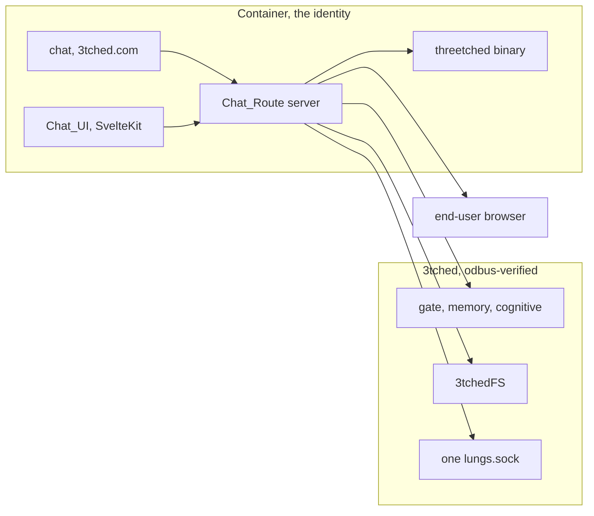

# Design — Container chat

Status: draft. Authorizes no file move, container start, or deploy. Chat is
the part that changes. The 3tched base and the network host bridge stay
where they are.

## Overview

`/srv/git/3tched.com` is the container repo. It owns all of chat, the range
of services, and the threetched install. Chat runs inside the container.
That is where the gate passes. Host port 8080 does not pass.

The `identity-chat-interface` spec in `/srv/git/odbus-verified` is the
previous design. Its Host_Dashboard placement and unresolved blockers are
resolved here: the chat process runs only in the container, the Bound_Identity
is the container, and the Lungs_Socket is the only hop into 3tched.

threetched is the upstream ZeroClaw binary, renamed, with no patches. It is
binary-backed. It is not our code and not 3tchedFS.

## Architecture

Install is two repos. The container repo installs on the 3tched base.
Runtime crosses: chat calls 3tched for the gate and the filesystem, and
calls the binary for models, providers, and skills.

## Components and interfaces

### Chat_Route

The Chat_Route is a Rust process inside the container. It owns:
- Session management and identity binding (Bound_Identity from
  `identity_sled.get_own_identity` through the FUSE mount).
- Credential handling (Secret_Guard).
- Schema validation against sealed method schemas.
- The confirmation gate for mutation methods.
- The tool executor that maps model tool calls to FUSE Operation_File calls.
- The chain verifier that links Receipts to Execution_Records.
- The turn loop that runs model steps until tools are exhausted or the
  Session_Mode limit is reached.
- The tool registry derived from the Bound_Identity's mounted schemas.

The Chat_Route does not spawn `3tched-fs`. It does not open a listening socket.
It does not connect to Door_8090 directly. It reaches the 3tched base only
through the Lungs_Socket.

### Chat_UI

The Chat_UI is a SvelteKit / Svelte 5 application using the AI SDK Chat
component with a custom gRPC-Web ChatTransport. It delivers the conversation
stream to the end user's browser. It renders via json-render Svelte. The
container does not run a desktop or Wayland compositor. The user's browser
renders the page.

### threetched binary

The upstream ZeroClaw binary supplies models, providers, and skills. The
Chat_Route calls it through the AI SDK provider package. 3tched does not
grow a second implementation of it. The threetched binary is installed on
top of base 3tched as part of the container deployment.

### Bound_Identity and 3tchedFS

The chat process runs under the sealed identity of the container. Its mount
carries the identity. Every Operation_File call uses the Bound_Identity's
mounted namespace. The mount is a runtime mirror of SHM. The sealed catalog
may name `threetched` as the binary surface. That name is the binary, not
a second copy of our code.

### Lungs_Socket

One socket, `/run/opdbus/lungs/lungs.sock`. The Chat_Route connects to it
from the container. The kernel peer distinguishes callers. The network does
not implement this socket. The chat does not create a socket per caller.

### Secret_Guard

The Secret_Guard classifies output items as containing Credential_Material
when they include a complete credential value, a 16+ byte substring, or a
SID1/OIA1 envelope. It blocks the output on the server, keeps pending
Tool_Calls unchanged, and records a security event. For message streams, it
checks each chunk with a hold-back buffer so values split across chunks
are detected before any byte leaves the Chat_Route.

### Confirmation_Gate

Holds pending mutation calls, computes a digest from the validated input,
accepts an approve/reject from the Chat_UI as a separate request, and
atomically consumes each event for at most one call. Pending calls expire
at 300 seconds.

### Tool_Executor

Executes each Tool_Call as one Operation_File call. Reads back
Authoritative_State through the granted read method. Handles timeouts,
Unknown_Outcome, and Denial. Sends no repetition for mutation methods.

### Chain_Verifier

Links Receipts to Execution_Records, verifies `prev_hash` continuity,
displays `verify_integrity` results if exposed, and reports verified,
broken, or unverified for each Chat_Session.

### Feed_Consumer

The Chat_Route reads the Bound_Identity's mounted views for plugin state.
The Feed_Credential_Check runs before any feed byte reaches the Chat_UI.
The Chat_UI never opens EMQX or MQTT. A Catalog_Hint is the only feed
signal for a catalog-pin re-read, and that re-read uses the mount.

## Data models

No new identity store. The container is the identity the gate already knows.
Chat does not invent a second identity on the host. Model choice is the
binary's, not a new table in 3tched.

## Error handling

No container means chat fails closed. It does not fall back to host chat or
to port 8080. A missing threetched binary fails the model call and does not
get reimplemented inside 3tched. An undecided render transport does not
justify binding 8080. A bridge artifact with no 3tchedFS is a failed build.
A host caller, including anything bound to port 8080, does not pass the gate.
A missing container caller fails closed.

## Testing strategy

Prove the caller that passes the gate is inside the container. Prove a host
caller and a host :8080 listener do not pass. Prove model selection goes to
the threetched binary and the gate stays a call into 3tched. Prove identity
binding, secret guard, confirmation gate, tool execution, and chain
verification. Do not start the stopped container and do not deploy as part
of this draft.
